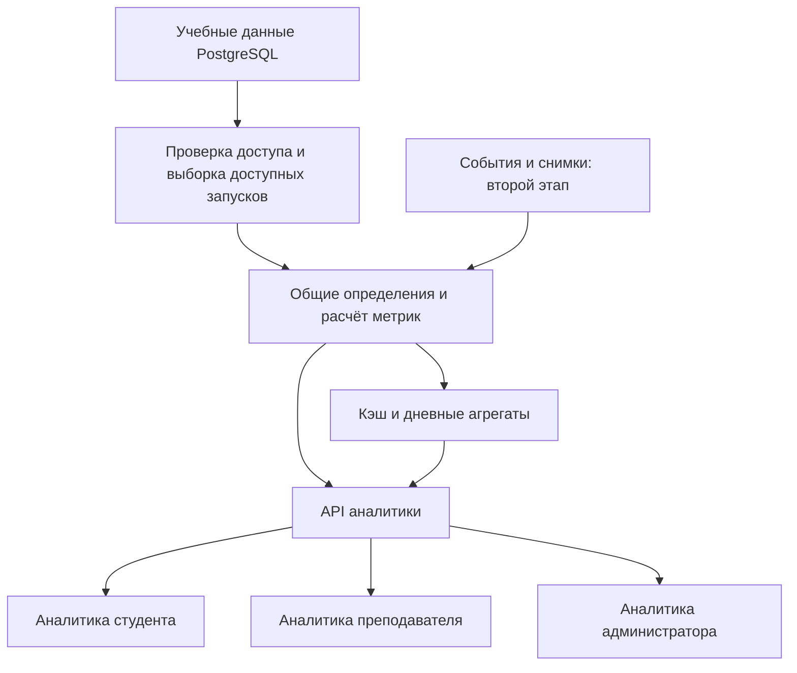

# Архитектура аналитики LMS

Дата исходного проекта: 24.10.2026. Обновление 25.10.2026: реализованы аналитические кабинеты, графики, сравнение входного/итогового тестов, история наблюдаемого прогресса, активность, входы и устройства. Актуальные возможности и ограничения — в [ANALYTICS_GUIDE.md](ANALYTICS_GUIDE.md). Ниже сохранён исходный план; полная история ответственности за проверки, неизменяемые версии содержания и часть дальнейших оптимизаций остаются направлениями развития.

## 1. Назначение

Аналитика помогает принять конкретное решение:

- Студенту — понять свой результат, найти затруднение и выбрать следующее действие.
- Преподавателю — увидеть, кому нужна помощь, какие задания вызывают трудности и что пора проверить.
- Администратору — оценить состояние обучения, распределение нагрузки и задержки по всей платформе.

У каждого кабинета свой раздел «Аналитика». Формулы общие, доступ к данным различается по роли и назначениям. Существующие очереди, журнал и карточки ответов остаются рабочими инструментами: аналитика ведёт к ним по ссылкам.

## 2. Что действительно есть в проекте

| Данные | Источник | Что можно получить сейчас |
|---|---|---|
| Записи на обучение, группа, статус, последняя открытая учебная ступень | `courses.Enrollment`, `CourseRun` | Состав группы, текущие статусы, последнее открытие шага |
| Содержание, обязательность и пороги прохождения | `learning.Module`, `Lesson`, `Step` | Текущий состав программы и обязательные шаги |
| Отметки теории, решения и критерии прохождения | `StepProgress`, `learning.services` | Текущий прогресс по существующим правилам LMS |
| Письменные ответы, даты отправки, баллы, опоздание, срок и ответственный | `assessment.Submission` | Отправки, текущая очередь, текущие задержки и сохранённый факт опоздания |
| История проверки и возвратов | `GradeReview` | Кто, когда и какую проверку выполнил; изменения оценки |
| Тесты, выбранные варианты, завершение и баллы | `QuizAttempt`, `Question` | Результаты тестов и ошибки по вопросам |
| Отправки Python и результаты проверки | `codejudge.CodeSubmission` | Принятые решения, попытки, ошибки проверки и ошибки сервиса |
| Настройки сроков и личные продления | `ActivitySchedule`, `AssignmentExtension` | Текущие условия сдачи; у отправки также есть `due_at_snapshot` |
| Часть изменений доступа и настроек | `communication.AuditEvent` | Записанные административные действия |

`assessment.management_views` уже даёт оперативный контроль: текущие счётчики, учеников, преподавателей и очередь. Его можно развить общими сервисами аналитики, сохранив существующие API.

Ограничения текущей истории:

- `last_seen_at` означает открытие учебного шага, а не любое действие пользователя и не измеренное время учёбы.
- При снятии отметки теории `StepProgress` удаляется: полного журнала переходов состояния нет.
- Изменения опубликованной программы могут изменить процент прогресса. Снимков состава программы по дням сейчас нет.
- Ответственного и `review_due_at` можно менять; полной истории интервалов ответственности и действовавших сроков нет.
- `GradeReview` хранит действия, поэтому число проверок/возвратов не равно числу уникальных проверенных работ.
- Максимальный балл письменного задания не записан в каждой отправке как исторический снимок. Историческую нормированную оценку нельзя обещать без проверки неизменности шкалы.
- Старые попытки со статусом `expired` и неполные старые данные требуют явной пометки, а не придуманного восстановления.
- Уведомления и аудит не покрывают все учебные действия. Их нельзя использовать как универсальный журнал активности.

## 3. Экран студента

Порядок: сводка → результаты по курсам → трудности → следующие действия.

| Блок | Содержание | Переход |
|---|---|---|
| Мой прогресс | Выполненные и все обязательные шаги по каждой записи на обучение; процент по текущей программе | Продолжить курс |
| Задания | Нужно выполнить, возвращено на доработку, ожидает проверки, проверено | Конкретное задание |
| Результаты | Баллы и максимум по заданию/тесту, лучший завершённый результат, число попыток | Свой ответ и комментарий |
| Где возникли трудности | Незавершённые задачи, повторные неуспешные попытки, вопросы с ошибками — только в пределах правил раскрытия ответов | Повторить материал или написать преподавателю |
| Сроки | Ближайшая сдача, личное продление, задержка проверки отдельно от опоздания ученика | Мои задания и сроки |
| Динамика, второй этап | Выполненные шаги и учебные действия по дням с даты начала достоверного сбора | Период / курс |

Пока нет правил весов, общий «средний балл за всё обучение» не вводим. Теоретический шаг, тест из двух вопросов и письменная работа на 100 баллов не должны случайно иметь одинаковый или произвольный вес.

Число попыток используем для объяснения учебного процесса. Само по себе большое число попыток не означает плохой результат.

## 4. Экран преподавателя

Начальные фильтры: курс, конкретная группа/самостоятельный запуск, период. По умолчанию — только доступные преподавателю запуски.

| Блок | Показатели | Действие |
|---|---|---|
| Группа | Число учащихся, текущий прогресс, распределение результатов, завершённые прохождения | Открыть список учеников |
| Нужна помощь | Условия с понятной причиной: просроченная доступная задача, повторные неуспешные попытки, отсутствие зафиксированного продвижения | Открыть ответы или написать ученику |
| Трудные задания | Доля успешных первых попыток, доля решивших хотя бы раз, количество участников и попыток | Посмотреть вопрос/условие и ответы |
| Проверки | Назначенные мне и все проверки доступных групп, просроченные, без ответственного, возраст очереди | Проверить, переназначить или изменить срок в рабочем экране |
| Моя работа | Уникальные работы с первой проверкой, действия проверки/возврата, время до первой проверки | История проверок |

Таблица учеников: имя, группа, прогресс, текущие задачи, результат, последнее зафиксированное учебное действие, причина внимания и ссылка на подробности.

Для самостоятельного курса отсутствие активности не является опозданием, если срока нет. Будущие, скрытые и ещё не открывшиеся задания не включаются в список нарушенных сроков. Порог отсутствия продвижения настраивается; на первом этапе показывается честная дата последнего открытия шага, а не недостоверный статус «не учился».

Сигналы внимания — объяснимые условия для помощи. Они не меняют оценки, доступ или статус ученика автоматически.

## 5. Экран администратора

Порядок: состояние платформы → проблемы → преподаватель/курс/группа → конкретные работы и результаты.

- Обучение: уникальные учащиеся и записи на обучение отдельно; активные и завершённые прохождения; распределение текущего прогресса.
- Преподаватели: действительные назначения, объём очереди, возраст работ, задержки, уникальные проверенные работы и число действий проверки.
- Курсы и группы: состав, результаты и задания с трудностями. Группы сравниваются с учётом дат старта и формата обучения.
- Ответственность: работы без назначенного проверяющего, текущие просрочки, переназначения и сроки — по мере появления достоверной истории.
- Динамика: новые записи, первые проверки и учебные действия за период; завершения курса по дням — после введения истории завершений.
- Экспорт: отфильтрованный отчёт с определениями показателей, периодом, часовым поясом и датой формирования.

Не вводим единый рейтинг «лучший преподаватель» по числу проверок или средней оценке. Размер группы, сложность курса, пересдачи и изменение назначений влияют на эти числа. Показываем измеримые факты и состав выборки.

Контроль не подменяет пользователя. Личные сообщения не включаются в аналитическое хранилище; действующие правила доступа к переписке сохраняются.

## 6. Единицы учёта и определения метрик

Главная единица учебного результата — `Enrollment`: один человек в одном запуске курса. Один студент в двух группах — два прохождения и один уникальный человек. Для сложности задания единица — пара «задание/версия + Enrollment». Для проверки — отправка; для действий проверяющего — отдельный `GradeReview`.

| Показатель | Определение |
|---|---|
| Текущий прогресс | Выполненные обязательные шаги / обязательные опубликованные шаги текущей программы; те же правила, что в учебном движке. При нулевом знаменателе показываем «Нет обязательных шагов» |
| Групповой прогресс | Среднее процентов по выбранным прохождениям, с указанием их количества. Не среднее всех попыток |
| Статусы письменных задач | Последняя отправка по паре Assignment + Enrollment; старая возвращённая отправка не делает уже исправленную задачу снова «на доработке» |
| Очередь проверки | Все реальные отправки в статусе `submitted`. Если у одной задачи несколько ожидающих отправок, показываем и число отправок, и число учебных задач отдельно |
| Текущая просрочка проверки | Ожидающая отправка с текущим `review_due_at <= as_of`; работа без срока учитывается отдельно |
| Действия проверки | Все GradeReview за период, отдельно graded и returned; повторное редактирование оценки тоже действие |
| Впервые проверенные работы | Уникальные отправки, у которых первая содержательная проверка произошла в периоде. Позднее изменение оценки не создаёт ещё одну впервые проверенную работу |
| Время до первой проверки | Первая проверка/возврат минус submitted_at. Показываем медиану и p90, количество наблюдений; непроверенные работы остаются отдельной очередью с её возрастом |
| Соблюдение срока проверки | Первая проверка не позже срока, действовавшего на тот момент. Вводится после сохранения истории ответственности/сроков; текущий срок не используется для переписывания прошлого |
| Опоздание сдачи | Сохранённые `Submission.is_late` и `due_at_snapshot` для конкретной отправки; первая сдача и доработка считаются отдельно. Доля считается только среди отправок с известным сроком |
| Лучший результат | Лучший действующий завершённый результат по заданию и прохождению в соответствии с текущими правилами LMS; незавершённая/возвращённая работа не превращается в оценку 0 |
| Успех первой попытки | Прошедшие по критерию первой завершённой допустимой попытки / прохождения с такой попыткой; рядом число участников. Сбой проверяющего сервиса не считается учебной ошибкой |
| Вопросы с ошибками | По первой завершённой попытке каждого прохождения для сравнимости; отдельно неверный ответ и отсутствие ответа. Вторая вкладка может показывать все попытки |
| Активный учебный день, второй этап | День с подтверждённым учебным действием: выполнение шага, отправка ответа, сохранение ответа теста и т.п. Открытие главной страницы и фоновый heartbeat сами по себе не подтверждают обучение |
| Завершение курса за период, второй этап | Исторический переход в completed, записанный в событии; новые обязательные шаги не стирают прошлое событие. Повторные завершения выделяются отдельно |

Тесты учитываются в состоянии `finished`, включая корректное автозавершение. Старые `expired` выводятся отдельно с описанием старого поведения. Для Python running и service_error отделяются от завершённых учебных попыток.

«Текущий результат» и «результат за период» — разные представления. Например, текущий лучший балл учитывает все действующие попытки, а число отправок за неделю — только отправки недели. Период не применяется к каждому источнику произвольно.

Для каждой карточки задаются: формула, источник, единица учёта, временное поле, включённые статусы, исключения, размер выборки, дата актуальности и доступная глубина истории. Недоступная метрика показывается как «Данных пока нет», не как ноль.

## 7. Архитектура приложения

Сохраняем Django, React и PostgreSQL. Добавляем модуль `analytics` внутри существующего приложения.



Предлагаемая структура:

```text
backend/analytics/
  access.py              # собственные результаты / доступные запуски / платформа
  definitions.py         # определения, версии и описание метрик
  selectors.py           # фильтры и пакетные запросы
  metrics/
    progress.py
    assessments.py
    reviews.py
    activity.py
  services.py            # сборка ответов по ролям
  views.py, urls.py
  exports.py
  models.py              # события и агрегаты со второго этапа
  management/commands/analytics_worker.py
  tests/

frontend/src/pages/analytics/
  StudentAnalytics.tsx
  TeacherAnalytics.tsx
  AdminAnalytics.tsx
  components/            # фильтры, карточки, графики, таблицы и пояснения
```

В существующих `learning`, `assessment`, `codejudge` остаются правила прохождения, выставления оценок и проверки решений. Аналитика их использует и не вводит альтернативные пороги или второй журнал оценок. `management_views` постепенно обращается к общим сервисам вместо дублирования формул.

В первой версии запросы рассчитываются по исходным данным, пакетно через ORM/SQL. Исторические агрегаты и отдельная инфраструктура не являются условием запуска первой версии.

## 8. API и фильтры

Предлагаемые маршруты:

| API | Доступ |
|---|---|
| `GET /api/analytics/me/overview/` | Только собственные результаты, включая явное личное обучение преподавателя |
| `GET /api/analytics/me/enrollments/<id>/` | Только собственная запись |
| `GET /api/analytics/teaching/overview/` | Преподавательские назначения текущего аккаунта |
| `GET /api/analytics/runs/<id>/students/` | Преподаватель данного запуска, команда курса, администратор |
| `GET /api/analytics/runs/<id>/assessments/` | Та же область доступа |
| `GET /api/analytics/teaching/reviews/` | Проверки в доступных запусках; назначенные мне отдельно |
| `GET /api/analytics/admin/overview/` | Администратор |
| `GET /api/analytics/admin/teachers/` | Администратор |
| `GET /api/analytics/admin/courses/` | Администратор |
| `GET /api/analytics/exports/...` | Те же права и фильтры, что у исходного отчёта |

Общие фильтры: курс, запуск, период, статус обучения; для администратора — преподаватель. Любой переданный ID пересекается с доступной пользователю областью на сервере. Преподавательская аналитика администратора по назначению должна считать его фактические назначения, а не автоматически всю платформу из-за глобальной роли.

Ответ содержит `scope`, `filters`, `as_of`, `timezone`, `metric_version`, `coverage_start`, размер выборки и пагинацию. Новые графики не раскрывают студенту правильные ответы действующего теста; подробности используют существующие правила доступа.

Хранение дат — UTC. Для дневных отчётов задаём один явно указанный часовой пояс организации, первоначально `Asia/Qyzylorda`; сейчас Django настроен на UTC, поэтому группировка дней должна выполняться явно. Интервалы переводим из календарных дат отчёта в UTC с полуоткрытыми границами [начало, конец). Экран и экспорт используют одинаковые границы.

## 9. История и новые данные: второй этап

### LearningEvent

Поля: UUID события, тип и версия схемы, серверное время действия и получения, actor_id, enrollment_id/run_id при наличии учебного контекста, тип и ID источника, версия содержания, ключ идемпотентности и ограниченный набор служебных атрибутов.

События: выполнение/снятие отметки шага, отправка работы, проверка/возврат, завершение теста, завершение проверки Python, изменение статуса обучения. Просмотры шагов фиксируются отдельно и не смешиваются с выполнением. Счётчики учебных результатов получают события только от сервера, после проверки прав и успешного изменения источника.

Тексты сообщений, полные ответы, код решений и содержимое файлов не копируются в аналитические события. Их источники уже существуют и открываются через действующие разрешения.

### История ответственности и сроков

Добавляем `ReviewAssignmentHistory`: отправка, ответственный, начало/окончание интервала, срок, кто и почему изменил назначение. При первой проверке сохраняем действовавший срок и интервал ответственности. Так перенос срока или назначение другого преподавателя не меняет прошлую статистику.

Работу, которую проверил другой преподаватель, учитываем как выполненную у фактического автора проверки; ответственность за очередь относится к соответствующим интервалам назначения. Новые назначения начинают достоверную историю с даты запуска этой модели.

### История программы и результатов

`EnrollmentDailySnapshot`: запись на обучение, дата отчёта, версия программы, количество обязательных и выполненных шагов, статус, дата расчёта. Уникальность по записи, дате и версии определения метрик. Снимок отражает состояние на дату, а не пересчёт сегодняшнего содержания в прошлом.

Нужна неизменяемая версия/снимок учебной программы с составом, обязательностью и порогами. Версию максимально возможных баллов сохраняем в фактах оценки; для тестов уже есть max_score в попытке. Уменьшение процента из-за добавления содержания подписывается как изменение программы, а не потеря знаний.

Исторические дни до появления снимков не заполняются сегодняшним процентом. Частично восстановленные графики получают отметку покрытия и точности.

### Доставка и пересчёт

Событие предметного действия сохраняется в той же транзакции, что изменение учебного источника. Отдельный worker обрабатывает сохранённые события, строит агрегаты и помечает обработку идемпотентно. `on_commit` может ускорять запуск, но не заменяет устойчивый журнал в БД.

У обработчика — уникальность по event_id + версии проекции; повторная обработка не добавляет второй балл или второе действие. Поздно поступившее событие пересчитывает затронутый день. Параллельные транзакции не должны теряться из-за одного курсора «максимальный ID»: используются записи необработанных событий и подтверждение обработки.

Начальная реализация worker может использовать PostgreSQL и отдельный процесс, как существующий фоновый обработчик уведомлений. Обработчики не связываются в один цикл так, чтобы тяжёлый отчёт задерживал уведомления или завершение тестов. Redis/Celery и отдельное хранилище вводятся при измеренной необходимости.

## 10. Обновление, безопасность и качество

- Рабочая очередь остаётся оперативной. Аналитические сводки можно кэшировать до минуты, графики — до пяти минут; на экране всегда есть время расчёта.
- Перед чтением кэша заново проверяются полномочия. Ключ учитывает пользователя/область доступа, доступные запуски, фильтры, часовой пояс и версию формулы. Отозванное назначение не сохраняет доступ к старому отчёту.
- Агрегаты восстанавливаются из источников/событий. Они не являются источником оценки или правила допуска к уроку.
- Экспорт использует ту же область доступа и определения, ограничение объёма и защиту CSV-ячеек от формул. Большие выгрузки позже выполняются фоново.
- Удаление данных учитывает связанные события и агрегаты: личные сведения удаляются или обезличиваются по принятой политике, без скрытой копии ответов в JSON.
- Малая выборка, неизвестный срок и отсутствие событий отображаются явно. Задержка worker не превращается в учебную ошибку.
- Проверки: межгрупповая изоляция, один студент в нескольких запусках, прямые ID, изменение назначений и кэш, личное обучение преподавателя, несколько попыток/проверок, возврат с исправлением, сервисный сбой Python, автозавершение теста, пустой знаменатель, полночь в часовом поясе отчёта, дубли/запоздалые события и изменение программы.

## 11. Порядок реализации

1. **Зафиксировать определения и доступы.** Метрики, знаменатели, периоды и примеры на существующих данных. Разделить текущие показатели и исторические графики.
2. **Первая рабочая аналитика.** Три раздела: студент — прогресс/результаты/задачи; преподаватель — группа/трудности/проверки; администратор — обучение/нагрузка/задержки. Общие фильтры, пояснения и переходы к действиям. ORM/SQL по текущим источникам.
3. **История и динамика.** События, история ответственности, версии программы, дневные снимки. Только затем графики изменения прогресса, соблюдение сроков проверок в прошлом и активные учебные дни.
4. **Развитие по использованию.** Сравнение сопоставимых групп, экспорты, настройка сигналов внимания и оптимизация тяжёлых запросов. Учёт времени — отдельная опция после определения метода измерения.

Предлагаемый первый приоритет: помочь преподавателю найти учеников с трудностями и просроченные проверки, студенту — увидеть свой следующий шаг, администратору — понять причину задержки и ответственного. Эти сценарии уже обеспечены большей частью исходных данных и дают проверяемый результат.
