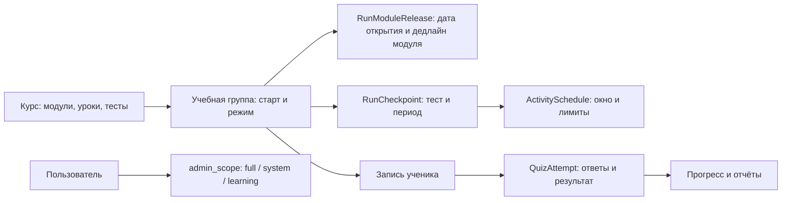

# Дедлайны модулей, контрольные тесты и администраторы

## Как настроить группу

Преподаватель открывает курс, выбирает нужную группу или самостоятельный запуск → **Учебный план → Сроки модулей**. У каждого модуля есть необязательная **Дата открытия** и **Дедлайн прохождения**. Даты задаются вручную, без обязательного номера недели. Чтобы снять ограничение по сроку, нажмите **Убрать дедлайн** и сохраните план. Начало обучения можно оставить пустым, если оно не нужно для общего доступа или расчёта контрольных тестов.

Время вводится в локальном часовом поясе браузера и хранится в UTC. **После дедлайна доступ сохраняется**: незавершённый модуль отмечается просроченным, его можно пройти позже. Полностью пройденный модуль не считается просроченным. Если ученик выполнил остальные обязательные шаги, а письменный ответ ждёт преподавателя, отображается «На проверке». Отдельные сроки заданий, окон тестов и окончания обучения продолжают действовать самостоятельно; дедлайн модуля не переписывает их и не снижает оценки.

Ученик видит срок в учебном плане, программе курса и разделе **Мои задания и сроки**, включая календарь. Преподаватель видит число пройденных/просроченных модулей и ожидание проверки. Данные вычисляются по серверному времени и текущим обязательным опубликованным шагам; незаполненные/необязательные модули без обязательных шагов не создают ложных просрочек. Студенческий план обновляется каждые 30 секунд; редактируемый план преподавателя автоматически не перезагружается.

Для открытия используется заданная дата, а не наступление очередной недели. Публикация и обязательный предыдущий модуль остаются условиями доступа. Сроки одного запуска не меняют другие группы и исходные даты модулей. Новые модули не закрываются автоматически из-за отсутствия номера недели. Существующие недельные планы читаются для совместимости: в форме показываются их фактические даты, а при сохранении преподавателем они становятся явными датами без сдвига расписания. Обновление приложения само по себе планы не пересчитывает.

## Контрольные тесты

Для тестов при необходимости остаются недельные и четырёхнедельные периоды. Учебная неделя контрольных тестов — семь суток от даты начала обучения. Эти периоды не управляют открытием модулей.

| Период теста | Открытие модуля | Обычное окно контрольного теста |
|---|---|---|
| Неделя 1 | По дате преподавателя | От старта +5 до +7 суток |
| Неделя 2 | По дате преподавателя | От +12 до +14 суток |
| Неделя 3 | По дате преподавателя | От +19 до +21 суток |
| Неделя 4 | По дате преподавателя | От +26 до +28 суток |
| Контроль за первые 4 недели | — | От +28 до +30 суток |
| Контроль за следующие 4 недели | — | От +56 до +58 суток |

«Месяц» здесь означает **четыре учебные недели**, как согласовано, а не календарный месяц. Недельный тест по умолчанию доступен последние два дня недели, а четырёхнедельный контроль — следующие два дня после завершения четырёх недель. Окончание группы должно включать время сдачи контрольного теста. Даты теста и открытия конкретного модуля можно переопределить. На точной границе открытия доступ уже разрешён; на границе закрытия новая попытка запрещена. Таймер попытки также ограничен закрытием теста и окончанием группы.

Для каждого периода выбирается отдельный тест курса. Тест можно создать рядом с планом; перед доступом ученикам его нужно опубликовать в разделе «Тесты». Учитель видит черновики и может подготовить план заранее. Тест, назначенный только одной группе, не появляется у других групп. Обязательность и проходной процент задаются в плане; обязательные опубликованные контрольные тесты входят в завершение курса. Один тест, используемый также в обязательном шаге, считается один раз с более высоким проходным порогом.

После появления попыток нельзя удалить, заменить, перенести тест или поменять проходной порог; результаты сохраняются. Даты таких тестов нельзя обойти через обычный редактор сроков. Дату старта группы после контрольных попыток переносить нельзя. Окончание группы не может отсечь назначенный тест. Попытки и их лимиты используют существующий механизм тестирования, оценок и отчётов.

Дедлайны можно задавать и для самостоятельного запуска курса. Дата завершения модуля должна быть позже его открытия/старта обучения и не позже окончания выбранного запуска, если оно задано. Редактирование начала/окончания группы не позволяет сделать уже заданные дедлайны недостижимыми. Модульный дедлайн можно продлить даже после контрольных попыток, если расписание самих контрольных тестов не меняется.

## Две административные области

| Задача | Системный администратор | Администратор обучения | Владелец с полным доступом |
|---|---|---|---|
| Состояние базы, диска, хранилища, проверка S3 | Да | Нет | Да |
| Входы, устройства, технические события | Да | Нет | Да |
| Пользователи, создание/удаление учётных записей студентов | Да | Нет | Да |
| Все курсы, команды, группы, учебные планы | По личному назначению в курс | Да | Да |
| Все результаты, проверки и учебная аналитика | По личному назначению в курс | Да | Да |
| Назначение административной области | Нет | Нет | Да |

Владелец открывает **Пользователи → Назначить область ответственности** и выбирает существующего пользователя. Роль и имя хранятся отдельно. Административная область проверяется сервером на каждом запросе; скрытие меню дополняет проверки. Саморегистрация не даёт административных прав. Системный администратор не получает автоматически полномочия преподавателя всех курсов. Действующие владельцы сохранили полный доступ. Для проверки созданы отдельные демонстрационные аккаунты двух областей; реальные назначения сотрудников выполняет владелец. Учётные записи, матрица доступа и инструкция: [ADMIN_ROLES_GUIDE.md](ADMIN_ROLES_GUIDE.md).

Веб-интерфейс системного администратора показывает состояние приложения. Он не выдаёт shell-доступ и не заменяет администрирование ОС, backup PostgreSQL или мониторинг сервера.

## Схема данных

Изменения плана сохраняются транзакцией и попадают в журнал курса. Назначение административных прав и проверки S3 попадают в отдельный системный журнал. Настройка S3 описана в [S3_STORAGE_GUIDE.md](S3_STORAGE_GUIDE.md).

При разделении ролей использован обычный для LMS принцип: техническое администрирование отделено от управления обучением, аналогично [Manager role в Moodle](https://docs.moodle.org/400/en/Manager_role). Конкретные полномочия BTBS приведены в таблице выше.

Если курс предназначен только для учебных групп, закройте запись на его самостоятельный запуск в «Группы и команда». Сроки применяются только к выбранной группе или самостоятельному запуску.
