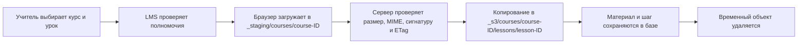

# S3: файлы каждого курса — 04.11.2026

LMS автоматически выбирает папку по курсу, уроку и назначению файла. Преподаватель загружает файл в привычном редакторе; создавать папки или открывать AWS вручную не нужно. Все курсы используют существующий приватный bucket `btbs-lms-media-506546664509-eu-north-1`.

## Структура

```text
_s3/
  courses/
    course-10/
      images/                         изображения описания курса
      lessons/
        lesson-25/
          videos/                     MP4 / WebM
          materials/                  документы и файлы урока
          images/                     иллюстрации внутри текста
      groups/
        run-16/
          assignments/
            assignment-8/
              answers/
                enrollment-21/
                  attempt-1/          файл первой отправки
                  attempt-2/          файл следующей отправки
_staging/
  courses/
    course-10/
      lessons/
        lesson-25/                    незавершённые прямые загрузки
```

Числа в примере условные: программа использует реальные ID базы. Имена самих объектов — UUID и расширение; одинаковые исходные имена не перезаписывают файлы. Имена учеников и текст курса не попадают в служебный путь. В интерфейсе остаются названия материалов, а не UUID.

В S3 папки — это общие префиксы ключей. Папка курса появляется после первого загруженного файла; пустые папки создавать не требуется. [Документация AWS о префиксах](https://docs.aws.amazon.com/AmazonS3/latest/userguide/using-prefixes.html).

## Почему ID, а не название

`course-10` остаётся тем же при смене названия или преподавателя. Урок можно переместить в другой модуль того же курса: ID урока и файлы остаются стабильными. Номер модуля и учебная неделя не входят в путь; доступ по расписанию проверяет LMS. Общие материалы курса не дублируются на каждую группу. Только ответы студентов разнесены по группам, заданиям, записи на курс и попытке.

ID курса виден в адресе `#course=10`. Системному администратору доступен раздел **Система и хранилище → Файлы по курсам**: название, счётчики и префикс S3. Этот список строится по базе, не скачивает файлы и не выполняет дорогой обход bucket. Счётчики отражают ссылки LMS на файлы, а не общий размер bucket с резервными копиями.

## Загрузка



Изображения курса, иллюстрации и файлы ответов проходят через backend и используют тот же генератор путей. Видео и материалы с прямой загрузкой попадают сначала в staging. Клиент не может указать чужой курс или итоговый ключ; окончательный путь формируется на сервере из отношений базы.

Сохраняются действующие лимиты и проверки: прямая загрузка видео до 2048 МБ, документов до 20 МБ, проверка типа/размера и приватные подписанные ссылки. Папка сама по себе не даёт права доступа: перед выдачей ссылки LMS проверяет запись на курс, публикацию и расписание. IAM-права остаются в `_s3/*` и `_staging/*`; новые разрешения не потребовались. Lifecycle через сутки применяется только к staging.

## Копирование и удаление

При копировании курса S3-материалы и изображения копируются сервером в папку нового курса. ID иллюстраций в тексте меняются на новые. Записи студентов, отправки и оценки не копируются. Если последующее сохранение курса завершается ошибкой, транзакция откатывается, а новые неиспользуемые объекты удаляются или попадают в очередь повторного удаления. Исходный курс не зависит от копии.

Для старого локального режима сохраняется совместимость с общими неизменяемыми файлами. Команда переноса в S3 разделяет и такие ссылки по владельцам. Удаление файлов LMS всегда работает по точным ссылкам и с проверкой оставшихся ссылок в базе; рекурсивное удаление префикса курса не используется. Исторические резервные объекты, сохранённые при переносе, автоматически не удаляются.

## Перенос старой структуры

04.11.2026 перенесены пять существующих ссылок из `_s3/migrated/` в папки `course-1`, `course-2`, `course-4`, `course-10`. Старые S3-объекты и локальные оригиналы сохранены. Содержимое старого и нового объекта каждого файла сверено по SHA256; защищённые скачивания и Range GET работают.

Резервная копия базы: `.local/backups/before-course-storage-20261104/database.json`. Журнал прежних и новых ключей: `organization.json` в той же папке. Он содержит модель, ID записи, ID курса и пути. Перед откатом нужно сверить фактическую ссылку в базе; журнал записывается до коммита каждой операции, поэтому при аварии последняя строка может описывать незавершённую операцию. Не восстанавливайте всю старую базу поверх более новых учебных результатов.

Команды из `backend/`:

```powershell
# Только показать план; ничего не меняет
.\.venv\Scripts\python.exe manage.py organize_media_by_course

# Перенести один курс с новым журналом восстановления
.\.venv\Scripts\python.exe manage.py organize_media_by_course --course-id 10 --execute --report ../.local/course-10-move.json

# Перенос только прежних локальных файлов тоже использует новую структуру
.\.venv\Scripts\python.exe manage.py migrate_media_to_s3 --execute
```

Повторный запуск пропускает уже организованные ссылки. Перенос идёт пофайлово: завершённые операции остаются при сбое, исходники сохраняются, после исправления ошибки можно продолжить с новым журналом. Существующий журнал команда не перезаписывает. Совместимый `migrate_media_to_s3 --execute` автоматически создаёт журнал в `.local/backups/`.

Оплата S3 учитывает сохранённые резервные копии и операции копирования. Переименование и перенос объектов в S3 выполняются копированием; [описание AWS](https://docs.aws.amazon.com/AmazonS3/latest/userguide/copy-object.html). Автоматическое удаление резервных исходников, квоты по курсам, антивирус, HLS и CDN не входят в эту реализацию.
